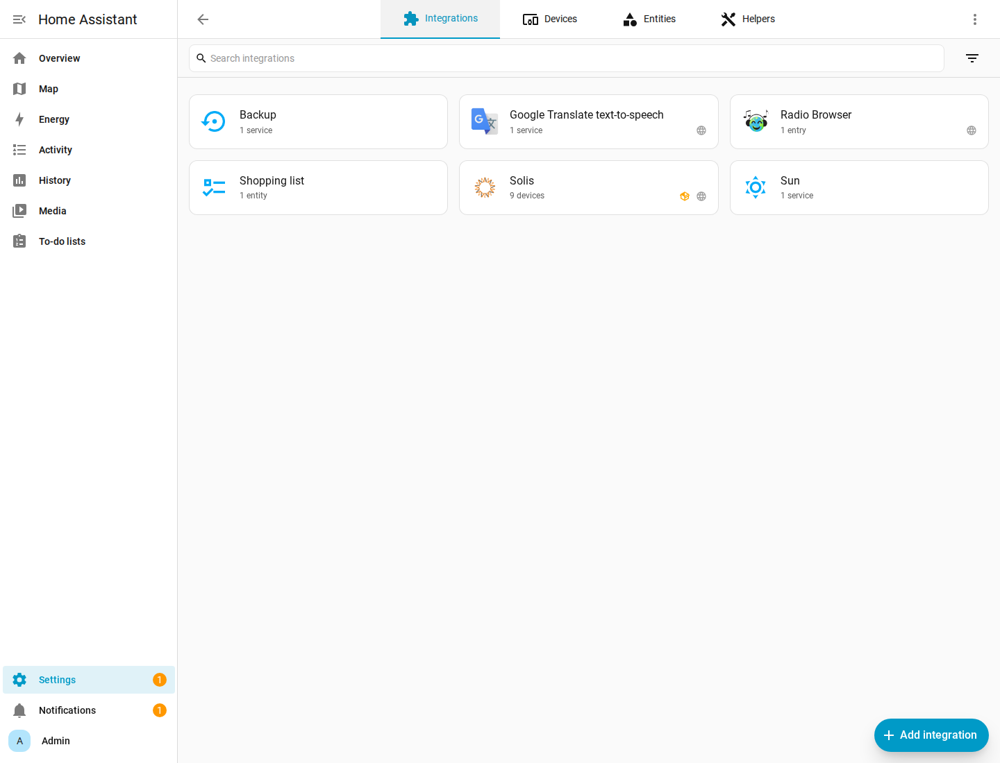
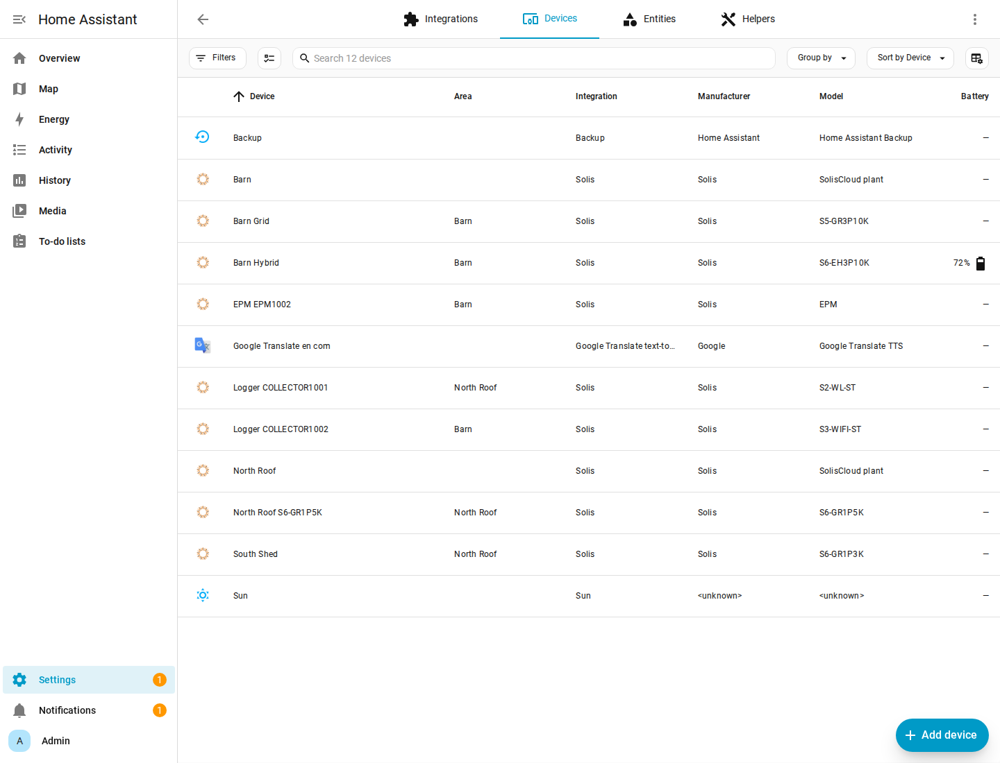
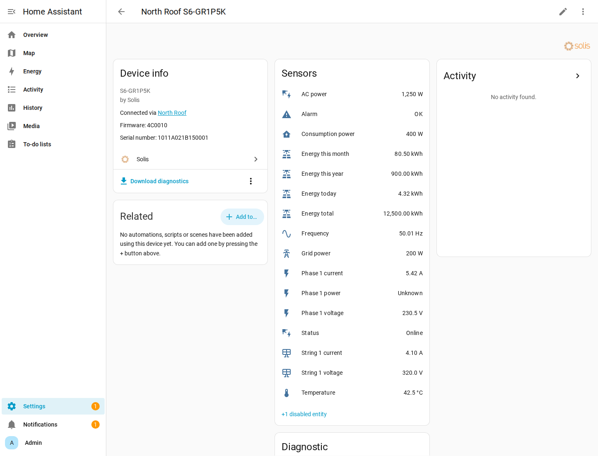
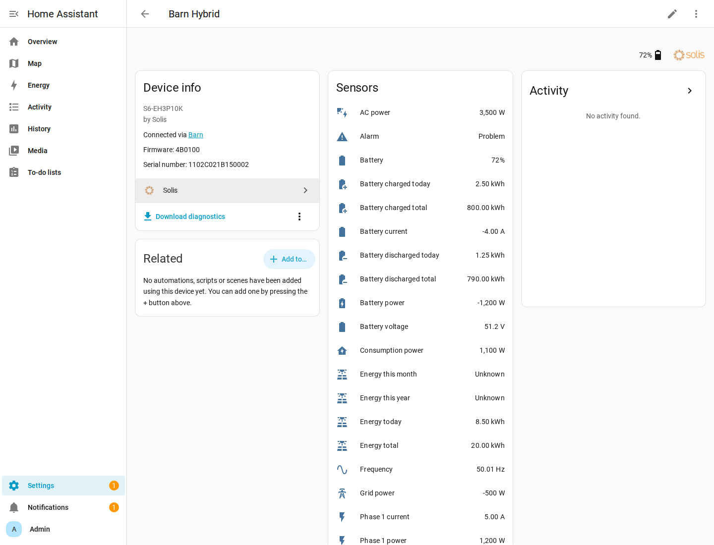

# Lab screenshots

Home Assistant 2026.11.1 against the mock SolisCloud API. The integration
list uses the Solis icon from `custom_components/solis/brand/`, which is the
image already published in home-assistant/brands.

North Roof single-phase inverter. AC power is 1,250 W because the mock sends
`pac` 1.25 with unit `kW`. Lifetime energy is 12,500 kWh because `eTotal` is
12.5 `MWh`.

Barn Hybrid. Battery power is −1,200 W because `batteryPower` is 1.2 kW and
`storageBatteryCurrent` is −4 A. State of charge is 72%. The alarm binary
sensor is on.

