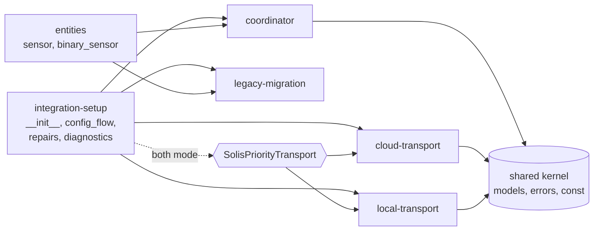

## Shape

A single Home Assistant custom component, `custom_components/solis`, plus
development tooling under `tools/` and `scripts/`. One config entry is one
SolisCloud account and/or one local logger. Each entry owns one
`SolisCoordinator`, which polls one **transport** and hands an immutable
`SolisSnapshot` to the entity platforms (`sensor`, `binary_sensor`).

## Modules

| Module | Owns |
| --- | --- |
| `integration-setup` | Entry lifecycle, transport assembly, config/options/reconfigure/reauth/DHCP flows, repair fix-flows, diagnostics. |
| `coordinator` | Poll loop, outage/sleep/lock handling, poll-interval backoff, repairs raised by polling, snapshot persistence. |
| `cloud-transport` | SolisCloud Platform API v2: signing, pacing, retries, parsing, unit conversion. |
| `local-transport` | Logger framings, register maps, the web-page transport and its cloud fill, logger-kind registry and detection, the local-first router. |
| `entities` | Devices and entities built from a snapshot; monotonic energy. |
| `legacy-migration` | Rewriting hultenvp/solis-sensor entity and device ids. |
| `dev-tooling` | Mock SolisCloud, logger emulators, Home Assistant labs, release and check scripts. |

The SolisCloud protocol and upstream background are in `solis-api-research`.

## The snapshot contract

`models.py` is the seam between transports and Home Assistant. Every
transport implements `SolisTransport.async_read() -> SolisSnapshot`; the
snapshot carries stations, inverters (with phases, PV strings, battery),
alarms, collectors and EPMs, plus a `source` (`cloud`, `local`, `asleep`,
or degraded) so entities can tell night from failure. Snapshots are frozen
dataclasses and round-trip through `snapshot_to_dict` / `snapshot_from_dict`
for the coordinator's store and diagnostics.

`errors.py` is the shared failure vocabulary. The coordinator decides
behaviour from the error class, not from messages:
`SolisAuthError`, `SolisClockError`, `SolisDataError` fail the update
immediately; rate-limit / server / timeout errors are transient and held;
`SolisLoggerOffline` means asleep or down; `SolisLoggerBusy` means a
locked session that must back off.

## Transport modes

`CONF_SOURCE` on the entry selects `cloud`, `local`, or `both`.
`integration-setup` builds a `SolisCloudTransport` for cloud, and a
`SolisPriorityTransport` wrapping a `SolisLocalTransport` (and the cloud
transport when present) for `local` / `both`. In `both`, local is preferred;
cloud fills missing energy counters and supplies a fresh sample while the
local session is locked. A web-page stick reports few fields, so there the
cloud also fills the rest from a sample read every five minutes. Cloud being
down does not drop a good local read,
and an asleep logger is not replaced by a stale cloud sample.

## Invariants

- **Entity platforms never do I/O.** They read the coordinator's snapshot
  only; no HTTP, socket, or transport call outside the coordinator.
- **Transports and codecs are Home Assistant–free.** `api`, `signing`,
  `parser`, `units`, `transport`, `local_transport`, `web_transport`,
  `cloud_fill`, `solarman`, `registers`, `loggers/*`, `models`, `errors`, `energy` and `const` import nothing from
  `homeassistant`, so the mock server and emulators in `tools/` reuse them.
- **No control path.** Nothing in the package writes to the inverter, calls
  the SolisCloud control endpoints, or issues a Modbus write function.
- **Zero runtime requirements.** `manifest.json` `requirements` stays empty;
  the Solarman V5 codec and Modbus clients are in-tree (rationale:
  `local-transport`).
- **Identity.** Entity unique ids are `{inverter serial}_{key}`; device
  identifiers are `inverter:{serial}`, plant, collector and EPM keys. Config
  entry unique ids are a logger serial or a prefixed token, never an IP.
  Cloud and local entries for one inverter share its device.
- **Connection identity is entry data; poll knobs are options.** Host, port,
  kind, slave, serials, detection code live in `entry.data`; scan interval,
  HTTP timeout, endpoint gap and plant timezone live in `entry.options`.
- **Runs on the minimum Home Assistant.** Code must load on the version in
  `hacs.json` (2025.10.0, Python 3.13) while development uses Python 3.14:
  ruff targets py313, and newer HA imports are guarded with fallbacks.

## Quality gates

Enforced in CI (`.github/workflows/`): ruff lint and format, `mypy --strict`
on the package, pytest with ≥ 95 % coverage overall and 100 % on
`config_flow.py`, hassfest, HACS validation, and a boot of the minimum Home
Assistant version (`scripts/check_minimum_home_assistant.py`). User-facing
changes carry a changeset under `.changeset/`; releases are tagged by the
release workflow, never from a pull request.

## Known structural debt

- `loggers/probe.py` imports private helpers from `local_transport`
  (`_detect_map`, `_serial_once`) and `solarman` (`_PacedClient`), and
  `local_transport` imports `loggers.probe` lazily to break the cycle. The
  probe code should get a public seam.
- `sensor.py` takes plant-day helpers (`resolve_zone`, `plant_period_start`)
  from the cloud `parser`; the timezone logic is shared, not cloud-specific,
  and could live outside the cloud module (unconfirmed whether this matters).
- `coordinator` imports `asleep_snapshot` from `local_transport` and
  `detection_why` from `loggers` to restore a night sample and describe the
  session in diagnostics.
